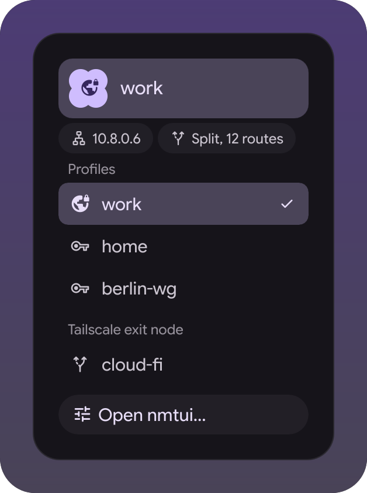

# VPN widget

A button in the bar's util group that says whether a tunnel is up, and a menu to
switch between profiles. Profiles are whatever NetworkManager knows - OpenVPN and
WireGuard both - plus tailscale exit nodes when tailscale is installed. A widget for
the [illogical-impulse extensions fork](https://github.com/Berupor/dots-hyprland-extensions).

| In the bar | The menu |
|---|---|
|  |  |

Nothing there is connected to anything: the scenes in `demo/` hand the views a
made-up tunnel, which is also how the tests run.

## Install

Settings → Widgets → Install a widget, paste:

```
https://github.com/Berupor/ii-widget-vpn.git
```

Needs `nmcli`; `tailscale` is optional and its section stays away without it.
Connecting and disconnecting go through `nmcli connection up/down` and
`tailscale set --exit-node`, so profiles that need a password ask for it the way
NetworkManager always does. Editing profiles is nmtui's job, and the menu has a
button for it.

The one option is a folder of `.ovpn` files: every file in it that NetworkManager
has not seen yet is imported as a profile, named after the file. Leave it empty and
the list is whatever is already in NetworkManager.

## Hacking

With the fork checked out next door, the scenes are both the tests and the pictures:

```sh
tests/qml-cases.sh    -x ~/.config/illogical-impulse/widgets/vpn
tests/widget-shots.sh -x ~/.config/illogical-impulse/widgets/vpn
```

`git config core.hooksPath .githooks` runs them on push. GPL-3.0.
